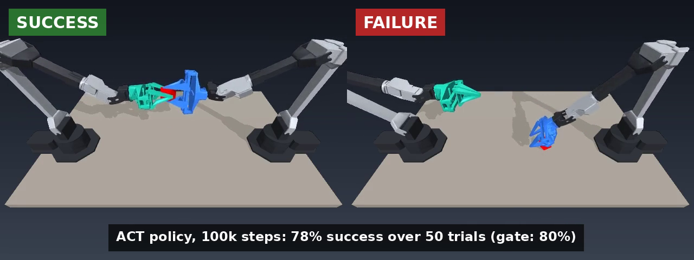

# Week 8: ACT on ALOHA sim (transfer cube)



*Left: success, the cube is passed in mid-air. Right: failure, the cube is lifted, then dropped; no handover.*

Gate, written before training:
- Success = the left gripper holds the cube in the air (env reward 4). *Clarified after training; the gate said "Success = pass".*
- Attempts = 50, because fewer attempts are not enough to judge how the trained policy behaves.
- Pass if success rate >= 80 % at 100k steps, because this time we train on all the data, so even the first training should succeed at least 80% of the time.

## Setup

| | |
|---|---|
| Policy | ACT (LeRobot 0.6.1, unmodified: [modeling_act.py](https://github.com/huggingface/lerobot/blob/v0.6.1/src/lerobot/policies/act/modeling_act.py)), chunk_size 100, n_action_steps 100 (re-plans every 2 s) |
| Data | `lerobot/aloha_sim_transfer_cube_human`, 50 human demos, 20,000 frames, one top camera |
| Env | `gym_aloha` `AlohaTransferCube-v0`, 400 steps = 8 s at 50 fps |
| Training | 100k steps, batch 8, seed 0, RTX 5070 Ti laptop (12 GB), ~5 h |
| Eval | 50 episodes per checkpoint |

How it was run:

```
MUJOCO_GL=egl lerobot-train --policy.type=act --dataset.repo_id=lerobot/aloha_sim_transfer_cube_human --env.type=aloha --env.task=AlohaTransferCube-v0 --steps=100000 --batch_size=8 --env_eval_freq=20000 --eval.n_episodes=50 --save_freq=20000 --seed=0 --policy.device=cuda --policy.push_to_hub=false --wandb.enable=false --output_dir=$HOME/act_runs/transfer_cube_seed0
```

The 20k eval crashed (`NamespaceNotFound: gym_aloha` in the async eval workers); training was resumed from the 20k checkpoint with `--eval.use_async_envs=false`.

## Result

| Checkpoint | Success (50 trials) |
|---|---|
| 40k | 74% (37/50) |
| 60k | 76% (38/50) |
| 80k | 66% (33/50) |
| 100k | **78% (39/50)** |

**Verdict: FAIL** (78% < 80%, by one attempt).

12 s test (diagnostic, after training): 100k checkpoint, `--env.episode_length=600` instead of 400, 50 trials: **72% (36/50)**. More time did not help, so the failures are stuck, not slow.

I expected the first training to pass 80%, but it did not. After 40k steps the success rate stopped improving, so I am counting this as a fail. In the videos the policy looks good, but it still fails 11 of 50 times, so it needs improving. It is not stuck in a loop; something stops it from improving after a certain number of steps. One fix could be more demos focused on the points where the trained model fails.

I believe more training steps will help, but only after we add demos focused on where the trained model is missing things.

Next test: add demos at the failure positions, same 100k steps. If success is still rising at 100k, then test longer training.

To know which change actually makes the model better, we have to test them one at a time, in sequence. Otherwise it is hard to tell what caused the improvement.

## Tools

`tools/eval_angle_cam.py` (written by Claude): runs `lerobot-eval` but records the video from the `angle` camera with recolored arms. The policy still sees the original `top` camera, so its behaviour is unchanged (checked: same 10 outcomes as the plain run).

```
MUJOCO_GL=egl python week8/tools/eval_angle_cam.py --policy.path=<checkpoint>/pretrained_model --env.type=aloha --env.task=AlohaTransferCube-v0 --eval.n_episodes=10 --eval.batch_size=1 --eval.use_async_envs=false --output_dir=<out>
```


## Hypothesis: re-plan more often (written before the sweep)

Now the question is how to improve the result. I have one idea to try, and I am writing my hypothesis down before running it.

The idea is to change only the prediction part. Right now the policy executes 2 seconds (100 steps) of actions and is blind until the next plan. If it misses the grasp, it cannot see that and correct it until those 2 seconds are over. So I want it to look again much sooner, for example every 0.2 seconds (10 steps).

I will run 100, 50, 20 and 10 steps (20 was actually run as 25). If none of them beats the previous 78%, I can conclude that being blind for 100 steps is not what causes the failures.

My prediction: more than 80%, whatever the setting.


## Re-planning sweep: results

Same 100k checkpoint, no retraining. Only `n_action_steps` (how many of the 100 predicted actions are executed before the policy looks again) changes. 100 episodes per cell. Script: [sweep.sh](sweep.sh).

| n_action_steps | re-plans every | seed 1000 (Nov 4) | seed 2000 (Nov 4) | both seeds |
|---|---|---|---|---|
| 100 (default) | 2 s | 76% | 83% | 159/200 = 79.5% |
| 50 | 1 s | 92% | 85% | 177/200 = 88.5% |
| 25 | 0.5 s | 63% | — | — |
| 10 | 0.2 s | 7% | — | — |
| 1 + temporal ensemble (coeff 0.01) | every step | 71% | — | — |

```
bash week8/sweep.sh 100 1000 "100 50 25 10"   # seed 1000 row (+ ensemble)
bash week8/sweep.sh 100 2000 "100 50"         # seed 2000 row
```

Run time: 15–25 min per setting for 100 episodes.

### Concepts from this sweep (reference notes)

**Seed.** The starting number of the random number generator. In this eval it fixes the list of cube positions, one per episode. Same seed = same 100 positions every time. A different seed = a different set of positions = a different "exam". Training has its own seed (`seed 0`), which fixes the starting weights and the data order; that is a separate thing.

**Compare only on the same seed.** The unchanged policy (setting 100) scored 76% on seed 1000 and 83% on seed 2000. Nothing about the robot changed; only the cube positions did. So 85% on seed 2000 cannot be compared with 78% from the training eval.

**Noise.** One run of 100 episodes at about 80% moves about ±4 points by chance alone. The gap between two such runs moves about ±6 points. A gap under about 2× that spread (about 10 points for two single runs) can easily be luck. Pooled over both seeds, the 9-point gap for setting 50 has a spread of about 3.6 points (about 2.5× the spread): suggestive, not proven.

**Chunking trade-off.** ACT predicts 100 actions at once. Each chunk is one consistent plan, but the human demos contain several valid ways to do the task, and each new query can pick a different one. Re-planning too often (10, 25) switches plans mid-motion, so the arm never finishes one → collapse. Re-planning too rarely (100) means the policy is blind for 2 s and cannot correct a missed grasp. The best setting is in between. The temporal ensemble removes the jumps but averages different plans into one that matches neither. This is the standard explanation; it has not yet been checked against the videos of these runs.

### What was real and what was luck (Woldemedihn)

A seed fixes where the cube is placed in each episode, so each seed is a fixed set of cube positions. Both settings have to run on the same seed. With different seeds, you cannot tell whether a change in the score came from the setting or from the cube positions.

On seed 2000, setting 50 beat setting 100 by only 2 points, inside the ±6 noise. So even though 92% looked like a good number, it was mostly luck.


## Where it fails (failure stages + videos)

Stage of each failed episode = its max reward (gym_aloha `tasks/sim.py`): 0 reach, 1 grasp, 2 carry (lifted, left gripper never touched it), 3 handover. Counted with [tools/count_failures.py](tools/count_failures.py).

| run | failures | reach | grasp | carry | handover |
|---|---|---|---|---|---|
| seed 1000, setting 100 | 24 | 0 | 7 | 17 | 0 |
| seed 1000, setting 50 | 8 | 0 | 2 | 6 | 0 |
| seed 2000, setting 100 | 17 | 0 | 5 | 12 | 0 |
| seed 2000, setting 50 | 15 | 0 | 0 | 15 | 0 |
| seed 2000, setting 50, re-run with all videos | 9 | 0 | 2 | 7 | 0 |
| seed 1000, setting 25 | 37 | 7 | 3 | 27 | 0 |
| seed 1000, setting 10 | 93 | 63 | 9 | 21 | 0 |
| seed 1000, ensemble | 29 | 6 | 9 | 14 | 0 |

**Runs are not deterministic.** The re-run of seed 2000 / setting 50 (same weights, same seed) scored 91% instead of 85%. All 9 of its failures were also failures in the first run; 6 episodes flipped from fail to success. So about 9 cube positions fail every time, and some borderline ones can go either way. Even the same seed moves a few points between runs. Videos for all 100 episodes: [tools/eval_all_videos.py](tools/eval_all_videos.py).

What I saw in the videos (Woldemedihn):

- With setting 100, when the robot misses the grasp it still lifts as if it held the cube, and only notices and retries much later. With setting 50 it notices within a short time and tries to grasp again. This is the "blind for 2 seconds" effect from my hypothesis, seen directly, and it is why setting 50 does better.
- The remaining failures are mostly at the handover: the cube is lifted, but the two arms do not meet in the right place, so the left gripper never touches it.

## Goal: beat LeRobot's published 83% (gate written before the run)

LeRobot's ACT on the same human data and task scores **83%** over 500 episodes ([model card](https://huggingface.co/lerobot/act_aloha_sim_transfer_cube_human)). A fair comparison keeps the same data (human demos), the same task and the same success definition. Scripted data would be a different benchmark.

**Gate:** ACT, 100k checkpoint, setting 50 (re-plan every 1 s), human data. Pooled over three eval seeds (1000, 2000, 3000), 100 episodes each, using only the **first** run of each seed: **pass if ≥ 88%**.
Why 88: with 300 episodes the gap to 83% has about ±2.5 points of noise; a real win needs about 2× that, so about 5 points above 83%.

Limit: one training run (seed 0); training-seed variance is not measured.


i also run in an other seeds and does the average i should have 264 and 88% but unfortunately i got 263 and 87.7% so that is a fails when i compare what i should have . 


so finally to test what is the issue we train for a 5 hours in a scripted which is only works in a simulation because it cheats so when it was traning it was 98% then i test it and it got 94.67 so we decide that the issue we have is the demo,

## Scripted-data results (numbers)

Same ACT, same 100k steps, same training seed 0. Only the data changed: `lerobot/aloha_sim_transfer_cube_scripted` (50 demos from a script that reads the true cube pose, so it only exists in simulation). 100 episodes per cell, eval seeds 1000/2000/3000, first run of each.

| policy | setting | seed 1000 | seed 2000 | seed 3000 | pooled | reach | grasp | carry | handover |
|---|---|---|---|---|---|---|---|---|---|
| human data | 50 | 92 | 85 | 86 | 263/300 = 87.7% | 1 | 4 | 32 | 0 |
| scripted data | 50 | 93 | 95 | 96 | 284/300 = 94.7% | 1 | 5 | 10 | 0 |
| scripted data | 100 | 95 | 95 | 96 | 286/300 = 95.3% | 0 | 10 | 4 | 0 |

- The 98% during training was the in-training check (50 episodes, setting 100), not this exam.
- Scripted vs human (setting 50): gap 7.0 points, about 3x the noise (±2.3), so real.
- Scripted setting 50 vs 100: gap 0.6 points, inside the noise, so no difference.
